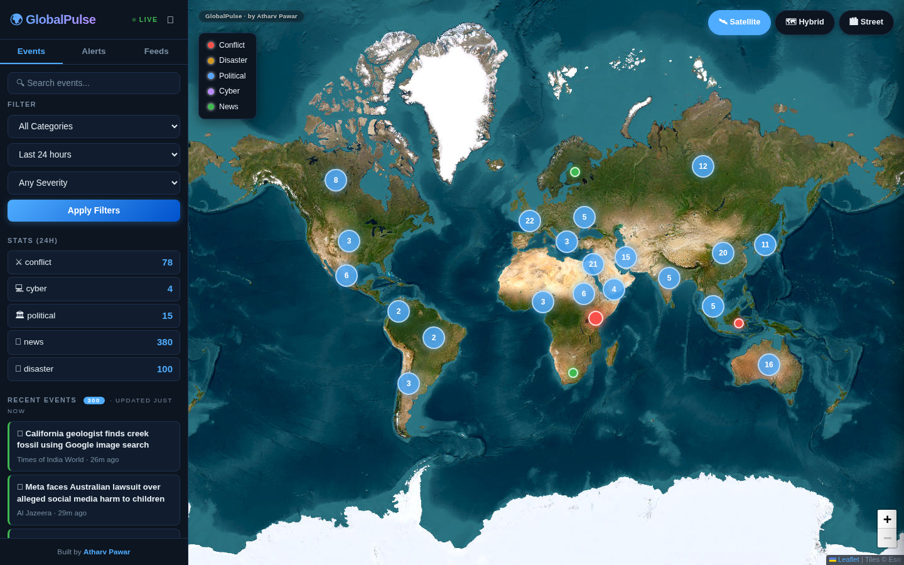

# GlobalPulse

A live map of what is happening in the world. It pulls news and alert feeds, sorts each headline into a category, pins it to a country, and shows everything on a satellite map that refreshes by itself.

**Live:** https://globalpulse-mdmw.onrender.com (free hosting, the first visit can take about a minute to wake up)

[](https://github.com/atharvpawar16/GlobalPulse/actions/workflows/ci.yml)



## Why I built it

News is scattered across dozens of sites. I wanted one screen where I could see conflicts, disasters, cyber incidents and politics at the same time, by place, without an account or an API key.

## What it does

- **Satellite, hybrid and street map** (Esri imagery through Leaflet), with clustered markers.
- **40+ feeds** read every 5 minutes: world news, security, disaster and cyber sources.
- **Auto sorting** of headlines into Conflict, Disaster, Cyber, Political and News using keyword rules.
- **Auto pinning:** the country named in a headline is looked up with Nominatim and placed on the map.
- **Filters and search** by category, severity, time range and text.
- **Custom alerts:** save a rule and get notified when a matching event arrives.
- **Live push:** new events reach open browsers over SignalR.
- **Dark and light theme**, and a layout that works on a phone.
- **Demo mode:** with no database configured it still runs on sample data.

## How the pieces fit

```
Browser (HTML, CSS, JS, Leaflet)
   |  REST + SignalR
   v
ASP.NET Core 9
   |- FeedIngestionService   reads the feeds on a timer, classifies, geocodes
   |- EventsHub              pushes new events to clients
   '- minimal API            /api/events, /api/events/stats, /api/alerts, /api/feeds, /api/health
   |
   v
PostgreSQL   tables: events, alert_rules, feed_sources
```

The frontend is plain HTML, CSS and JavaScript in `backend/wwwroot`. There is no build step.

## Run it locally

You need the .NET 9 SDK.

```bash
git clone https://github.com/atharvpawar16/GlobalPulse.git
cd GlobalPulse
dotnet run --project backend/GlobalPulse.Api.csproj
```

Open http://localhost:5164. It starts in demo mode.

To use a real database, set `ConnectionStrings__Postgres` to a PostgreSQL connection string (a free Neon database works). The tables are created on startup; `infra/db/init.sql` holds the same schema. `docker-compose.yml` is there for a container setup.

## Folders

```
backend/       API, services, SignalR hub, models, Dockerfile
backend/wwwroot/   the whole frontend
infra/db/      database schema
infra/nginx/   nginx config
.github/       CI workflow, issue and PR templates
docs/          screenshot
```

## Contributing and security

See [CONTRIBUTING.md](CONTRIBUTING.md) and [SECURITY.md](SECURITY.md).

## License

[MIT](LICENSE) (c) 2026 Atharv Pawar
